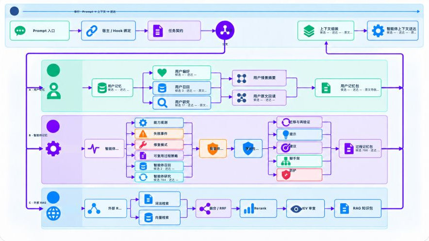
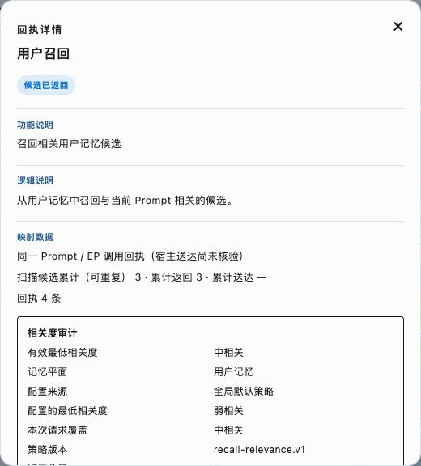
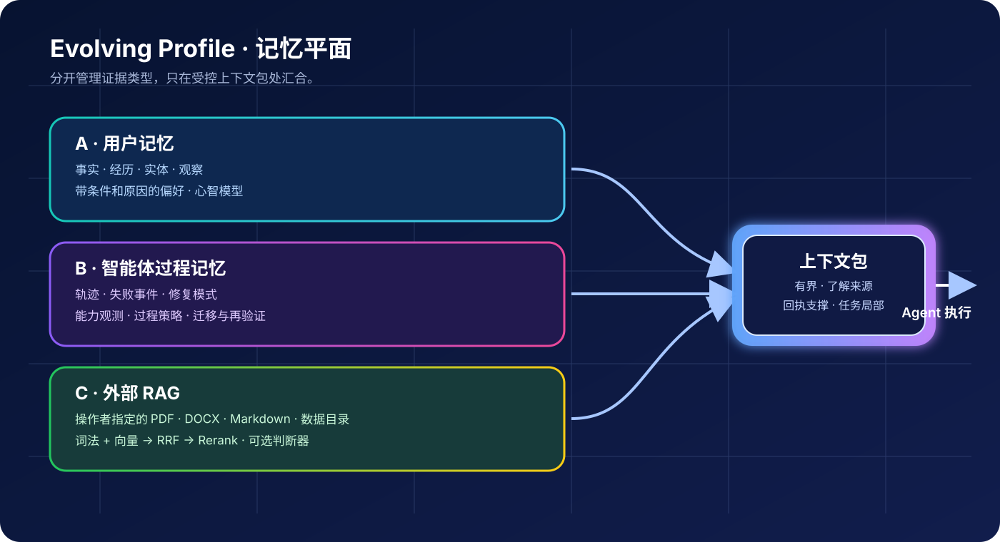
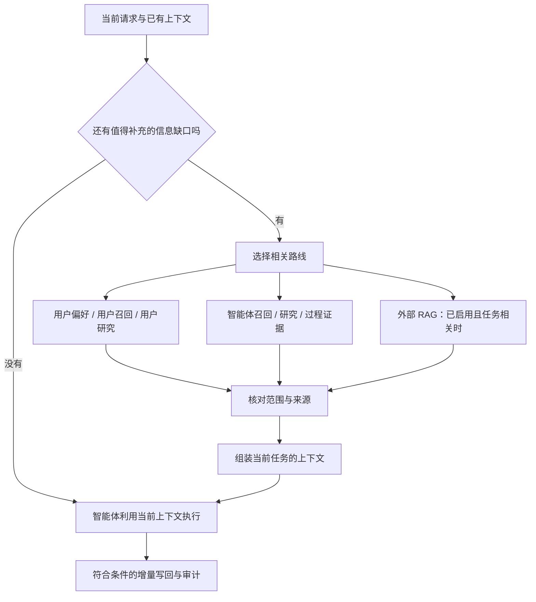

# Evolving Profile

<div align="center">

**让 AI 理解你、复用经验，并看清记忆如何参与每一次任务。**

面向长期 AI 协作的个人记忆、智能体过程经验与可观察工作流。

[English](README.md) · [快速开始](#ep-quick-start) · [工作逻辑](#ep-how-it-works) · [让智能体安装](#ep-agent-setup) · [发布状态](docs/RELEASE-LEDGER.md)

</div>

你已经解释过这个项目，智能体也解决过相似问题。
为什么换一个会话，还要重新交代背景，甚至看着它再次走同样的弯路？

**Evolving Profile（EP）**将用户知识、智能体过程经验与外部资料分开组织，再围绕
当前任务协调使用。你不仅能保留自己的事实、偏好和项目背景，也能积累智能体
执行任务时的失败、修复与可复用策略，并通过网页检查各条记忆路线的证据状态。

它不只保存“聊过什么”，还为继续做事提供可定位、可检查、可控制的长期上下文。


## 先看实际工作流



截图来自实际控制台中的既有历史审计记录，裁去了左侧私人 Prompt 列表；
历史来源归属不作为自然用户样本基准。图中的分支代表可选路线，
**不是每一轮都必须调用全部功能**。数字属于选中记录的可观察回执，不是召回准确率，
也不能单独证明最终回答采用了其中内容。

<details>
<summary>不只看图，还可以检查每个节点的回执</summary>



没有回执、已调用但返回空、候选被排除、宿主送达未知，是不同的状态。
点击节点检查对应证据，比笼统地说“AI 忘了”更容易找到原因。

</details>

## 六项核心能力

| 能力 | 为实际工作带来什么 |
| --- | --- |
| **用户记忆** | 分开组织事实、经历、实体、多维度偏好与心智模型参考，减少反复解释背景。 |
| **智能体过程记忆** | 不只保存最终答案，也保留轨迹、失败、修复、能力观测和可复用策略候选。 |
| **分层情景导航** | 先定位 Session 和任务阶段，再按需展开背景或回读原文。 |
| **外部知识隔离协同** | 资料文件夹可以参与任务，但 PDF 不会因此冒充你的历史经历或个人偏好。 |
| **记忆链路可观察** | 区分检索、筛选、返回、送达与原文回读，帮助定位问题发生在哪一步。 |
| **模块化配置** | 按需要配置记忆模块、模型服务、检索模型、可选判断器和预算。 |

这些能力提供的是结构化证据和可复用上下文，不代表所有旧记忆都正确，
也不承诺每项任务都会自动提升效果。

## 三类记忆，各司其职



**用户记忆**包含事实、经历、实体与关系、观察、条件化多维度偏好、心智模型参考和
情景导航。偏好应保留条件与例外；项目局部要求不能悄悄变成永久全局规则。

**智能体过程记忆**关注尝试了什么、哪里失败、如何修复、观测到什么验证，以及经验
是否适用于当前任务。失败事件、修复模式、过程策略、能力观测和迁移再验证各有位置。
它不是自动安装的 Skill，也不是强加给未来更强模型的永久命令。

**外部 RAG**用于操作者选择的 PDF、Word、Markdown 等资料集合，支持词法/向量检索、
倒数排名融合（RRF）、可选模型重排，以及索引兼容性与重建控制。
它是可选的外部知识路线，不是 EP 内部记忆必须再走一遍的第二套索引。

<a id="ep-how-it-works"></a>

## 一次任务如何使用 EP



同一个任务可以同时需要用户背景与智能体经验，因此允许组合路线；
用户明确限定来源时，以当前要求为准。

### 先导航，必要时再深入

情景摘要分为**紧凑、标准、完整三层**，用于定位会话、阶段、条件与后续纠正，
并不替代精确原话。

三层仍不够时，可以走有界的 Session/Project 原始历史读取路线。涉及人名、金额、
版本、否定、冲突和正式交付内容时，再按可用来源定位回读原文。
不同定位使用不同读取工具：本地 transcript 路径不等于 Bank 的 `read_source` ID。

### 证据状态分开，记忆才更可控

```text
发现候选 ≠ 已返回 ≠ 已观测送达 ≠ 已读原文 ≠ 已确认答案采用
```

弱相关或未确认内容可以保留为查证线索，但不能自动升级成事实。
相关度设置可以保留弱相关背景并排除无关内容；相关度本身不是正确性评分。

## 适合哪些场景

- **跨会话继续项目：** 找到此前决定、约束与纠正，避免把同一机构的不同项目混为一谈。
- **适配协作习惯：** 根据当前任务读取条件化偏好，而不是把所有偏好塞进每个回答。
- **复用执行经验：** 检索过去的调试或制作经验，再核对前提是否仍然成立。
- **结合外部资料工作：** 对照个人历史与外部文档，同时保留来源边界。
- **排查记忆似乎失效：** 检查实际路线和回执，而不是仅凭回答猜测系统是否工作。

## 功能配置与成本控制

网页提供用户/智能体记忆模块、Provider/Fallback、Embedding/Rerank、外部 RAG、
情景摘要、JEV、备份和审计等设置。记录、检索和上下文使用职责不同；
关闭模块不等于删除已存数据。

- 按需选择本地或在线检索模型；保存名称不等于模型可加载，实际路径/服务和索引签名需要验证。
- 只为希望参与检索的资料集合启用外部 RAG。
- **JEV 是可选判断辅助：** 可参与已配置的路由或证据审查环节，不替代召回器，也不写入事实。
  关闭或不可用时，保持对应规则托底以及明确的未知/错误状态。
- 高风险判断需要单独主动启用；它不覆盖宿主原有的权限与来源核验边界。
- 后台提炼、在线向量服务和判断服务可能消耗 Provider Token；
  本地模型也有内存和启动成本。通过模块开关、按需展开、分页和预算控制，而不是假定记忆免费。

安装器不会开启实验性全历史模型试验。历史记录可能处于待审、保护或未知状态；
系统不会为了让面板变绿而抹去这些状态。

<a id="ep-quick-start"></a>

## 快速开始

**第一次安装看这里：**[后端与网页完整部署](docs/DEPLOYMENT-中文.md) →
[选择具体宿主](docs/HOST-SETUP-中文.md) → [复制对应 Agent 提示词](docs/AGENT-SETUP-中文.md)。
现有贡献分支仍叫 `release/5.1.0`，当前补丁版本读 [VERSION](VERSION)，
不能根据分支名或旧 RC 下载包判断最新版。

### 环境要求

- Python **3.11+**、`uv`、Node.js **20.9+**、npm 和 Git。
- 完整 API 需要 PostgreSQL/pgvector；内嵌数据库路线须明确安装 `embedded-db` extra。
- 可用的聊天模型与向量模型路线；聊天 Coding Plan 不一定提供向量服务。
- 本机实际验证平台为 macOS；Linux 需核对平台依赖，未认证 Windows 原生安装。

### 1. 一键安装构建

```bash
git clone --branch release/5.1.0 https://github.com/ccygod/evolving-profile-2.2.git
cd evolving-profile-2.2
./scripts/install-ep51.sh --mode local --no-launch
```

脚本执行预检与来源文本扫描，安装基础依赖，**先构建 SDK 再构建 Console**，
并生成本地启动清单；只在 `.env` 不存在时创建模板。
**它不会启动服务，也不会自动注册 MCP/Hook。**

`--dry-run` 用于不写文件的预演；`--skip-deps` 只用于这个目录已经装好依赖时，
首次安装不要使用。

### 2. 配置自己的服务

按 [API 配置说明](api/README.md) 填写本地 `.env`，准备数据库与向量服务。
基础安装不包含内嵌 PostgreSQL 或本地 ML，按选定路线安装相应 extra。
API、Controller 和宿主配置应使用同一个 Bank ID；只切换网页下拉菜单，
不等于已配置宿主的记忆命名空间。

发行包不包含作者的生产 Bank、私有对话、凭据或模型权重。
安装也不会默认开启 JEV、云备份和外部 RAG。

### 3. 启动 API 与网页

在仓库根目录、分别打开两个终端：

```bash
uv run --project api --env-file .env evolving-profile-api --host 127.0.0.1 --port 8888 --workers 1
```

```bash
node --env-file=.env console/bin/cli.js --hostname 127.0.0.1 --port 9999 --api-url http://127.0.0.1:8888
```

打开[本地控制台](http://127.0.0.1:9999)，创建自己的 Bank，验证健康接口、实际页面点击
及所选模型路线。详见[完整安装、升级与回退](docs/LOCAL-SETUP.md)。

接宿主工具还要启动 **QueryController**，最小合约、访问策略和完整命令见
[部署第4步](docs/DEPLOYMENT-中文.md#4-拉起后端和网页)。复制路线使用 `personal-memory`；
当前 stdio 适配器不会仅因 `EP_BANK_ID` 或网页选择器变化就改用其他 Bank。

**API/Console 能启动，不等于宿主已完整接入。** Controller、Hook、Guidance 和后台
Worker 有独立配置与就绪要求。API 的 HTTP MCP 握手不能证明宿主 `user_recall`、
`agent_research` 或上下文送达。不要在没有访问控制的情况下公开本地端口。

<a id="ep-agent-setup"></a>

## 让智能体帮你安装

先选实际入口。一句话可以说明目标，需要完整执行时连同下方链接中的长版提示词一起复制；
智能体仍需终端/浏览器权限和你自己的凭据。

| Agent 入口 | 一句话安装要求 |
| --- | --- |
| **Codex 桌面端 / CLI** | 按 EP 的 `docs/DEPLOYMENT-中文.md` 和 `docs/HOST-SETUP-中文.md` 的 Codex 部分安装当前发行分支，拉起后端与网页，只注册一个 EP，并实际验证记忆查询与允许记录任务的自动捕获。 |
| **Claude Code CLI** | 按 EP 部署及 Claude CLI 指南拉起本机后端与网页，用 `claude mcp add` 注册 stdio 工具并做真实读取，不把未经验证的自动记录说成完成。 |
| **Claude Code 桌面端，本地 Code 页** | 按 EP 桌面 Code 指南安装，复用正确的 MCP 且不重复注册，拉起后端与网页，在这次桌面会话内验证实际工具。 |
| **Claude Desktop 普通 Chat** | 按 EP 本地 MCP 指南连接已运行的后端；没有终端/浏览器工具就给出独立 CLI/Code 后端安装要求，不声称 Chat 已部署系统服务。 |

各提示词的源码地址均为 `https://github.com/ccygod/evolving-profile-2.2`，分支 `release/5.1.0`。
**[完整分宿主提示词（含 Hermes）直接复制](docs/AGENT-SETUP-中文.md)。**
长版包括备份合并、绝对路径、健康检查、网页点击、工具/捕获验收、配置生效、可选项和停止回退。

## 宿主兼容性

| 宿主 | 当前定位 | 不应直接推断 |
| --- | --- | --- |
| **Codex** | 当前实际验证较充分的 MCP/Hook、记忆路由、情景与回执路线 | 所有黑盒回答都提供了答案采用回执 |
| **Claude Code CLI** | 已有明确 stdio 注册步骤，目标宿主需实际验证查询 | 看到 MCP 就代表自动 transcript/Hook 捕获已认证 |
| **Claude Code 桌面 Code 页** | 本地会话可复用受支持的 CLI 配置，另有专项步骤 | CLI 工具列表证明桌面/云端/SSH 也已完成 |
| **Claude Desktop 普通 Chat** | 独立的本地 MCP JSON 接法 | 已有 `.mcpb` 一键包、Code Hook 或自动抓取全部聊天 |
| **Hermes** | 可复用共享记忆服务及兼容的 MCP/API 契约 | 能力探针、回执与安装流程已经完全相同 |

专项步骤已补全，但 Claude Code、Hermes 的原生生命周期增强和完整验收仍是后续方向，
不因文档有命令就宣称与 Codex 同等程度的完整适配。

网页的模块、相关度、Provider/fallback、模型与索引、RAG/JEV 和备份建议见
[配置怎么调](docs/DEPLOYMENT-中文.md#5-网页配置怎么调)。
**网页保存的 Provider profile 和手动 API 的 `.env` 不自动相等，必须核对后端实际读取的配置。**

## 可靠性、隐私与边界

- 候选、情景摘要和过程模式不是已核实的外部事实；助手声称完成仍保留对应证据等级。
- 工具调用或正文返回不能单独证明最终回答采用。
- 网页提供英文、中文等语言切换；后台诊断和用户原文并不保证全部自动翻译。
- 来源文本扫描不等于二进制图片审计或依赖风险认证。
- 全部历史的语义准确率和最终回答收益未取得全局认证。

产品版本读取 [`VERSION`](VERSION)。实际发布状态、测试、依赖风险和已知限制
见[发布说明](docs/RELEASE-NOTES-5.1.1.md)与[发布记录](docs/RELEASE-LEDGER.md)，
不在多个固定徽章中重复维护“最新版”。
依赖的生产分类审计、完整工作区审计和保留的 RC 风险分别见[依赖风险说明](docs/DEPENDENCY-RISKS.md)。

## 作者、来源与文档

EP 发行作者/维护者：**CCY**。[个人发行仓库](https://github.com/ccygod/evolving-profile-2.2)
与[上游贡献渠道](https://github.com/94Hao94/evolving-profile/pull/4)是同一条发行来源线，
不是两套不相干的实现。保留 [NOTICE](NOTICE.md) 与相应上游许可；
仓库拥有者、Git 提交身份和上游致谢分别记录。

- [English README](README.md)
- [本地安装与回退](docs/LOCAL-SETUP.md) · [API 配置](api/README.md)
- [完整部署](docs/DEPLOYMENT-中文.md) · [分宿主接入](docs/HOST-SETUP-中文.md) · [Agent 安装话](docs/AGENT-SETUP-中文.md)
- [更新日志](CHANGELOG-5.1.md) · [当前补丁说明](docs/RELEASE-NOTES-5.1.1.md)
- [唯一真相源](config/source-of-truth.json) · [安全策略](SECURITY.md)
