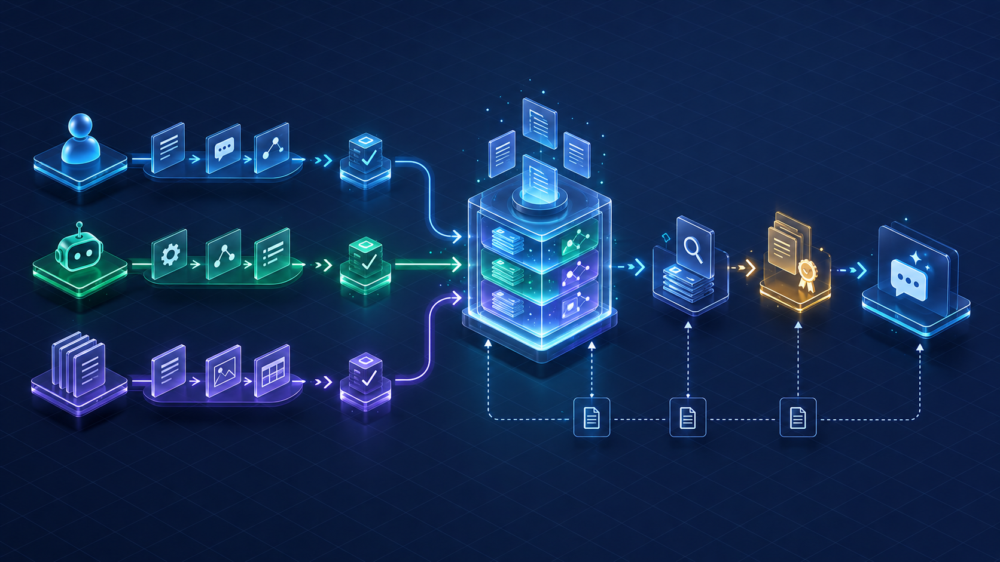
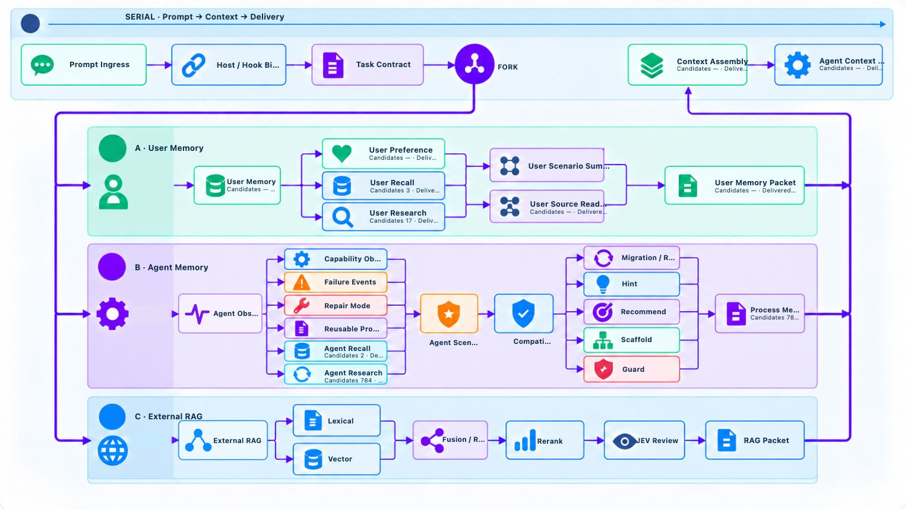
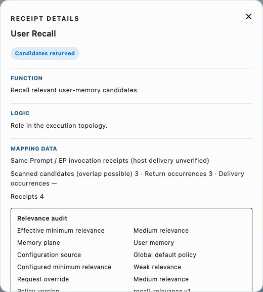
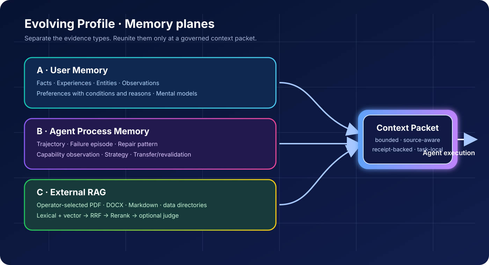
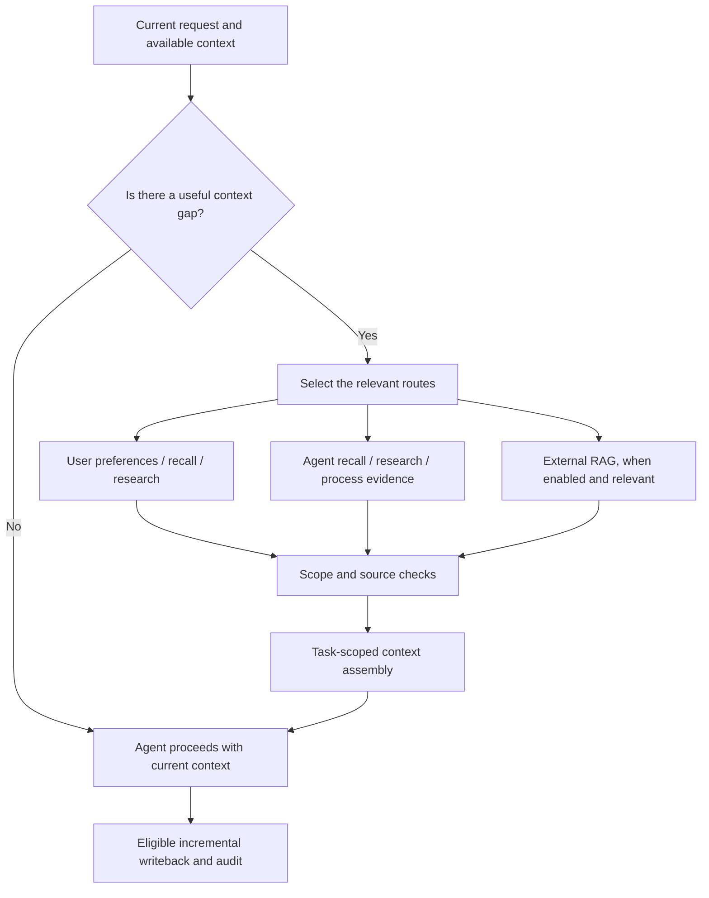

# Evolving Profile

<div align="center">

**Turn past conversations into personal context—and past work into reusable agent experience.**

Source-linked memory about you, how you work, and how your agent gets things done.

**Multi-dimensional evidence distillation · Five-dimensional preferences · Reusable agent experience · Observable execution**

[简体中文](README-中文.md) · [Quick start](#ep-quick-start) · [How it works](#ep-how-it-works) · [Agent installation](#ep-agent-setup) · [Release status](docs/RELEASE-LEDGER.md)

</div>

You have explained the project before. Your agent has solved a similar problem before.
Why do you still have to repeat the context—and watch it take the same detour?

**Evolving Profile (EP)** distills conversations and execution evidence into
**multi-dimensional personal memory and reusable agent experience**. It keeps
your facts, relationships, decisions and working preferences connected to their
sources, while separately organizing what the agent tried, where it failed,
how it recovered and which strategies have supporting verification.

The result is context for continuing work: an agent can find the right project,
adapt to how you prefer to collaborate, and consult relevant execution experience.
The console lets you inspect the extracted memory, correct preferences and trace
the evidence behind retrieval and delivery. Optional external documents remain
a separate knowledge source.



## See the workflow



A real console capture of an existing historical audit record, cropped to exclude
the private Prompt list. Historical source attribution is not a natural-user benchmark. Branches are
available routes, **not a claim that every route runs on every request**. Counts
describe the selected recorded invocation; they are not an accuracy benchmark or
proof that a final answer adopted the returned content.

<details>
<summary>Inspect a receipt, not just a diagram</summary>



Node details expose the evidence available for that step. No receipt, an observed
empty result, an excluded candidate and unknown host visibility are different states.

</details>

## What EP brings to your workflow

| Capability | Practical value |
| --- | --- |
| **Personal context with sources** | Organize facts, states, experiences, entities and relationships, with time and original evidence for checking earlier decisions. |
| **Five-dimensional preferences** | Adapt communication, learning, reasoning, collaboration and delivery to the task; inspect conditions, exceptions and cross-dimensional mental-model references. |
| **Agent experience that can be re-evaluated** | Connect trajectories and observations to failures, repairs, reusable strategy candidates, capability observations and migration/revalidation. |
| **Layered scenario navigation** | Locate the relevant Session and stage before expanding context or reading original evidence. |
| **Separate external knowledge** | Search your selected document collection without treating a PDF as your personal history or preference. |
| **Observable memory routes** | Diagnose whether a problem occurred during retrieval, admission, return, delivery or source readback. |
| **Modular controls** | Configure memory modules, providers, retrieval models, optional judges and budgets for the workflow you actually need. |

These capabilities provide structured evidence and reusable context; they do not
guarantee that every old memory is correct or every future task will improve.

## Maturity at a glance

**5.1.2 RC1 is a release candidate, not an all-platform stable certification.**
Product version comes from [VERSION](VERSION); channel/build metadata comes from
the checked [release manifest](config/release-manifest.json). Use the exact
[RC tag and assets](https://github.com/ccygod/evolving-profile-2.2/releases/tag/v5.1.2-rc.1).
Publication and contribution status are separate; older branches/assets are not this candidate.

| Area | Current evidence | Still needs validation |
| --- | --- | --- |
| User/agent memory, five-dimensional preferences, scenario/source navigation and observable topology | Existing implementation; macOS/Codex is the main exercised integration | Whole-history accuracy, universal answer benefit and every model/task combination |
| Host integrations management page | Implemented; real local Console clicks, Chinese/English, scroll and responsive checks | Native target-client acceptance is separate from this page |
| Governed stdio and optional authenticated HTTP | Isolated EP-side protocol/policy tests; new profiles default to read-only | Actual client receipt/use, remote/TLS operation and every lazy tool dependency branch |
| Claude CLI, local desktop Code and ordinary desktop Chat | Separate recipes and preparation profiles | Each actual surface's lifecycle, source capture, binding and end-to-end calls |
| Hermes, WorkBuddy and Doubao Work | Capability profiles, discovery, previews, guidance and diagnostics prepared | Native task/session evidence; no equal-validation claim with Codex |
| Windows native / WSL / remote | Separate modes, Unicode/UTF-8/path/lock preparation and manual CI definition | Actual Windows/PowerShell execution; WSL success is not native-Windows certification |
| External RAG / JEV / local models | Existing optional modules and configuration | Operator's actual files, keys, models, index compatibility and measured benefit |

“Detected”, “configured”, “EP protocol verified”, “host received” and “answer
adopted” are different claims. Missing evidence stays unknown, not zero or success.
See [candidate scope and acceptance](docs/RELEASE-NOTES-5.1.2.md).

## Personalization beyond a list of likes

EP extracts preferences across **five dimensions**, so personalization can affect
how a task is understood, discussed, executed and checked.

| Dimension | What it can capture | Illustrative preference |
| --- | --- | --- |
| **Communication & presentation** | Wording, tone, structure and visual presentation | “For status updates, lead with the result and then give the evidence.” |
| **Learning & understanding** | Explanation order, examples and learning methods | “Introduce a concrete example before the abstract mechanism.” |
| **Analysis & decision-making** | Evidence standards, alternatives and decision criteria | “Compare the tradeoffs and say which option you recommend.” |
| **Execution & collaboration** | Initiative, task scope, coordination and checkpoints | “Continue within the agreed scope; ask when the scope changes.” |
| **Quality & delivery** | Verification, acceptance criteria and deliverable expectations | “Render the document and inspect its pages before delivery.” |

These are examples, not installed defaults. An extracted preference can retain
its scope, applicability, exceptions, supporting quotes, review status and
superseding corrections. The console supports manual correction of its text and
conditions. **Fusion mental models** connect reviewed preferences across dimensions
to offer a broader reference for how someone works; they remain traceable,
conditional interpretations rather than a fixed personality assessment.

For the complete memory taxonomy, lifecycle and source-to-implementation map,
see [What EP can remember](docs/MEMORY-CAPABILITIES.md).

## Three memory planes, different responsibilities



**User memory** holds facts, experiences, entities/relations, observations,
conditional preferences, mental-model references and scenario navigation.
A preference retains its conditions and exceptions; a project-local instruction
should not silently become a permanent global rule.

**Agent process memory** follows what the agent tried, where it failed, how it
repaired the problem and what verification was observed. It organizes failures,
repair patterns, strategies, capability observations and transfer/revalidation.
Experience remains scoped to tasks, tools, time and available evidence; it is
not automatically installed as a Skill or a permanent command for newer models.
This is adaptation through stored evidence, selection and revalidation; EP does
not retrain the underlying model's weights.

**External RAG** is for an operator-selected collection of PDF, Word, Markdown
and other supported files. It offers lexical/vector retrieval, reciprocal-rank
fusion (RRF), optional model reranking and index compatibility/rebuild controls.
It is optional—not a second index that EP's internal memory must use.

<a id="ep-how-it-works"></a>

## How it works



The agent can combine routes when a task needs both personal context and
execution experience. Explicit source restrictions still take priority.

### Navigate first, expand when needed

Scenario Summary has **three tiers: compact → standard → full**. It locates the
conversation, stage, constraints and later corrections; it is not a substitute
for exact original wording.

When the summaries are insufficient, use the bounded original Session/Project
reading route. Use source readback for consequential names, amounts, versions,
negations and conflicts. The right reader depends on the available source
locator; a local transcript path is not automatically a Bank `read_source` ID.

### Keep evidence states distinct

```text
discovered ≠ returned ≠ delivery observed ≠ source read ≠ answer adoption confirmed
```

This separation makes weak or uncertain evidence usable as navigation without
turning it into a verified fact. Relevance controls can retain weak background
while excluding unrelated content; relevance is not a truth score.

## Typical uses

**An illustrative project handoff:** a proposal changes from an early draft to an
approved scope. EP can help locate the right Session, the later correction and
the original wording, while separately consulting preferences about how to
present the final document. A shared organization name alone is insufficient
to merge two projects.

**An illustrative repair:** an agent previously fixed a rendering failure.
Process memory can preserve the attempt, failure, repair and verification, then
offer a relevant strategy candidate for another task. A changed model or toolchain
still needs an applicability check; an old success is not a universal recipe.

- **Resume a project:** locate earlier decisions, constraints and corrections
  without merging unrelated projects from the same organization.
- **Adapt collaboration:** consult conditional preferences for the current task,
  rather than inject every preference into every answer.
- **Reuse execution experience:** retrieve earlier debugging or production
  lessons, then check whether their prerequisites still apply.
- **Work with outside documents:** compare your own history with a supplied
  document while preserving the two source categories.
- **Explain an apparent memory failure:** inspect the actual route and receipt
  instead of guessing that “the model forgot.”

## Configure behavior and cost

The web console exposes user/agent memory modules, Provider/Fallback,
Embedding/Rerank models, external RAG, Scenario Summary, JEV, backup and audit
settings. Recording, retrieval and context use have distinct responsibilities;
module switches do not mean deleting the stored records.

- Use local or online retrieval models where supported; verify the actual model
  path/service and index signature before treating it as ready.
- Enable external RAG only for the collections you want searched.
- **JEV is optional:** it can assist selected routing/evidence-review stages;
  it does not replace the retriever or write facts. Its configured rule-based
  fallback and unknown/error states remain visible.
- High-risk judgment is a separate opt-in setting, not permission to override
  the host's existing authority and source-verification boundaries.
- Background extraction and optional online judgment can consume provider
  tokens. Local models have their own memory/startup cost. Use module controls,
  bounded expansion, pagination and budgets rather than assume memory is free.

Experimental whole-history model trials are not enabled by the installer.
Existing historical records may remain pending, protected or unknown; those
statuses are not erased merely to make a dashboard green.

<a id="ep-quick-start"></a>

## Quick start

**Start here:** [complete backend/web deployment](docs/DEPLOYMENT.md) →
[choose your host](docs/HOST-SETUP.md) → [copy its Agent request](docs/AGENT-SETUP.md).
**Installing this candidate?** Start with [candidate setup](docs/CANDIDATE-SETUP.md).
**Agent reading this repository:** installation alone is not usage; read
[the Agent operating guide](docs/AGENT-USAGE.md) before choosing memory tools.
The existing contribution branch is named `release/5.1.0`; the current product
patch is read from [VERSION](VERSION). Branch names and old RC assets are not
automatic version indicators.

### Requirements

- Python **3.11+**, `uv`, Node.js **20.9+**, npm and Git.
- PostgreSQL with pgvector for the full API, or the explicitly installed
  `embedded-db` extra for a supported embedded route.
- A configured chat provider and a working embedding route; a chat-only plan
  does not necessarily include embeddings.
- macOS was exercised locally. Linux is a target with platform prerequisites;
  Windows-native installation is not certified here.

### 1. Install and build

```bash
git clone --branch v5.1.2-rc.1 --single-branch https://github.com/ccygod/evolving-profile-2.2.git
cd evolving-profile-2.2
./scripts/install-ep51.sh --mode local --no-launch
```

The installer filename is retained for the 5.1 release line; it reads `VERSION`.
Use the exact RC tag or named verified archive, not an older contribution branch.

This runs preflight and a release text-source scan, installs base dependencies,
builds the SDK **before** the Console and writes a local launch manifest.
It creates `.env` only when absent. **It does not start services or register MCP/Hook.**

Use `--dry-run` for zero-write inspection. Use `--skip-deps` only when this
checkout's dependencies already exist—not for the first install.

### 2. Configure your own services

Fill the generated local `.env` using [API configuration](api/README.md).
Prepare your database and embedding service. Base dependencies do not include
embedded PostgreSQL or local ML; select the required extras explicitly.
Use the same Bank ID in the API, Controller and host configuration. Changing a
Console selector alone does not configure a host's memory namespace.

No production Bank, private transcript, credentials or local model weights are
provided. JEV, cloud backup and external RAG are not enabled by installation.

### 3. Start API and Console

From the repository root, in separate terminals:

```bash
uv run --project api --env-file .env evolving-profile-api --host 127.0.0.1 --port 8888 --workers 1
```

```bash
node --env-file=.env console/bin/cli.js --hostname 127.0.0.1 --port 9999 --api-url http://127.0.0.1:8888
```

Open [the local Console](http://127.0.0.1:9999). Create your own Bank and verify
health, real page interactions and the chosen model route.
See [complete setup, upgrade and rollback](docs/LOCAL-SETUP.md).

For host tools also start the **QueryController**, using the fresh-install
contract/policy and exact command in [deployment step4](docs/DEPLOYMENT.md#4-start-backend-and-web-ui).
The copyable route uses `personal-memory`; the current stdio adapter does not
switch Banks merely because `EP_BANK_ID` or a Console selector changes.

**API/Console startup is not full host integration.** Controller, Hook, Guidance
and background workers have separate setup and readiness requirements. An API
HTTP MCP handshake does not certify host `user_recall`, `agent_research` or
context delivery. Do not expose local ports publicly without access control.

<a id="ep-agent-setup"></a>

## Let your agent set it up

Pick the actual host below. Paste the sentence together with the linked full
request when you want the complete checklist; terminal/browser permission and
your own credentials are still required.

| Agent surface | One-sentence installation request |
| --- | --- |
| **Codex desktop / CLI** | Use my supplied EP candidate, read its deployment and Agent-use guides, start my backend/UI, register EP once and verify actual reads and permitted automatic capture. |
| **Claude Code CLI** | Follow EP's deployment and Claude CLI guides, start my local backend/UI, register its stdio MCP with `claude mcp add` and verify a real read without claiming untested automatic recording. |
| **Claude Code desktop, local Code tab** | Follow EP's local Code-tab guide, reuse the intended MCP definition without duplicates, start backend/UI and verify tools in this actual desktop session. |
| **Claude Desktop, ordinary Chat** | Connect this Chat to my already running EP with the local MCP recipe; if terminal/browser tools are absent, give the separate CLI/Code backend request rather than claim system deployment. |
| **Hermes** | Inspect this Hermes installation's real MCP/API capabilities, use the supplied candidate and operating guide, and verify explicit reads before claiming automatic lifecycle. |
| **WorkBuddy** | Prepare host-specific configuration first; register only if the installed client and my authorization are present, then follow the Agent operating guide. |
| **Doubao Work** | Review the actual plugin setup, select it for this task and follow the operating guide; do not claim a Skill guarantees every-turn execution. |

Repository provenance: `https://github.com/ccygod/evolving-profile-2.2`.
Use the exact `v5.1.2-rc.1` tag or its named verified archive, not the old remote branch.
**[Copy the full per-host prompts, including Hermes](docs/AGENT-SETUP.md).**
They specify backup/merge, absolute paths, real health/UI/tool/capture acceptance,
effective configuration, optional features and safe stopping/rollback.

For day-to-day use after connection, give the Agent [AGENT-USAGE.md](docs/AGENT-USAGE.md).
It covers tool routing, current-prompt binding, source readback, failure recovery,
no-Hook behavior and host-specific limits. The machine-readable companion is
[agent-usage.v1.json](config/agent-usage.v1.json); it is advisory, not a permission grant.

## Host compatibility

| Host | Current position | Do not assume |
| --- | --- | --- |
| **Codex** | Most deeply exercised MCP/Hook, memory-route, scenario and receipt path | Every black-box answer has an adoption receipt |
| **Claude Code CLI** | Documented stdio registration recipe **plus, since 5.1.3, a host-adaptive Hook bridge** (capture + per-prompt recall context); exercised through the real bridge with simulated host markers | A live-CLI-session acceptance run, or certification by MCP visibility |
| **Claude Desktop — Cowork / local agent sessions** | **5.1.3: Hook plugin + bridge, desktop chats captured with `origin_agent=claude-desktop`, Scenario Summaries for desktop chats, health check** — exercised end to end on one macOS machine | Windows/Linux, other Desktop versions, or that every answer used the injected context |
| **Claude Code desktop — Code tab** | Local sessions can reuse supported CLI MCP configuration; separate recipe provided | CLI listing proves this desktop/cloud/SSH session works |
| **Claude Desktop — Chat** | Separate local MCP JSON recipe | A bundled `.mcpb` installer, Code hooks or automatic Chat history capture |
| **Hermes** | Shared memory services and compatible MCP/API contracts can be reused | Identical capability probes, receipts or onboarding |

### Claude Desktop and Claude CLI (new in 5.1.3)

One EP Bank can now be fed and read by **Codex, Claude Desktop and Claude CLI at the same time**, and the integration works out which host is calling by itself.
Full guide: **[docs/host-integrations/CLAUDE-DESKTOP-CLI.md](docs/host-integrations/CLAUDE-DESKTOP-CLI.md)** ([中文](docs/host-integrations/CLAUDE-DESKTOP-CLI-中文.md)).

- **Host-adaptive bridge** (`claude-code/hook_bridge_desktop.py`): one entry point for SessionStart, UserPromptSubmit, PreToolUse, PostToolUse, PreCompact and Stop.
  It detects Claude Desktop / Claude CLI / generic Claude Code (or an explicit `EP_HOST` override), tags every captured record with `origin_agent`, and never blocks Claude (always exit 0).
- **Only human-visible dialogue is retained.** Tool results, thinking, images, sidechains and system reminders are dropped, fixing the old behaviour where file dumps were stored as things *you* said.
- **Desktop chats reach Scenario Summaries**: a Codex-format rollout is written into EP's own `claude-code/rollouts/` (never `~/.codex`) after a settle period, so the background summariser is not invalidated mid-run.
- **Fact-extraction quote repair**: deterministic, fail-closed repair of almost-verbatim `source_quote`s, so fewer batches end in quarantine while the "exact substring of the claimed author's message" guarantee is kept. Kill switch `EVOLVING_PROFILE_API_QUOTE_REPAIR=0`.
- **One command to install, one to check**: `zsh claude-code/install.sh [--desktop-plugin]` (dry-run, backups, uninstall supported) and `python3 claude-code/compat/ep_desktop_health.py` (read-only OK/WARN/FAIL for every link, including read/write embedding-model consistency).
- Codex is untouched: `~/.codex/*` and `codex.json` are never read or written, and existing Codex data keeps `origin_agent=codex`.

**Evidence and limits, stated plainly:** developed and exercised on one macOS machine with Claude Desktop 3P. The CLI path was verified through the real bridge with simulated host markers, not in a live CLI session.
Hook activity proves context delivery, not that an answer used it. Desktop needs one `sudo` for the system plugin directory. Details and every known limit are in the guide and in [RELEASE-NOTES-5.1.3](docs/RELEASE-NOTES-5.1.3.md).

The new [host-preparation profiles and management tools](docs/host-integrations/README.md)
also cover WorkBuddy, Doubao Work and generic MCP clients. Profiles are implemented,
not merely a future roadmap; full target-host lifecycle certification is still pending.
See the [generated capability matrix](docs/host-integrations/MATRIX.md). It records
documented capabilities, not a native acceptance score. No equal-validation claim is made.

For recommended modules, relevance, Provider/fallback, model/index matching,
RAG/JEV and backup settings, read [web configuration guidance](docs/DEPLOYMENT.md#5-configuration-recommendations-in-the-web-ui).
**A saved UI Provider profile and the manual API's `.env` are not automatically
the same configuration.** Verify the effective profile before claiming changes applied.

## Reliability, privacy and limits

- Memory candidates, scenario summaries and process patterns are not verified
  external facts. Assistant completion statements retain their evidence level.
- Tool invocation and returned content do not prove final-answer adoption.
- UI language selection includes English and Chinese; backend-generated
  diagnostics and user-authored source text are not guaranteed fully translated.
- Source-text scanning is not a binary-asset audit or dependency-risk guarantee.
- All-history semantic accuracy and answer benefit are not globally certified.
- Always use the documented `--hostname 127.0.0.1`; the legacy bare Console CLI still defaults
  to all interfaces. This candidate does not silently change that default or authorize public exposure.

Product version: [`VERSION`](VERSION). Current release status, actual checks,
dependency risks and known limits belong in the [candidate notes](docs/RELEASE-NOTES-5.1.2.md)
and [release ledger](docs/RELEASE-LEDGER.md), not in a permanently duplicated badge.
See the [dependency risk disposition](docs/DEPENDENCY-RISKS.md) for the distinct
production-classified and full-workspace audit results and retained RC risks.

## Authorship, source and documentation

EP distribution author/maintainer: **CCY**. The
[personal distribution](https://github.com/ccygod/evolving-profile-2.2) and
[upstream contribution channel](https://github.com/94Hao94/evolving-profile) are
two channels for the same release line, not unrelated implementations.
Preserve [NOTICE](NOTICE.md) and the applicable upstream licenses. Repository
ownership, Git commit identity and upstream acknowledgment remain distinct.

- [中文介绍](README-中文.md)
- [Local setup and rollback](docs/LOCAL-SETUP.md) · [API configuration](api/README.md)
- [Deployment](docs/DEPLOYMENT.md) · [Host setup](docs/HOST-SETUP.md) · [Agent requests](docs/AGENT-SETUP.md)
- [Agent operating guide](docs/AGENT-USAGE.md) · [Candidate setup](docs/CANDIDATE-SETUP.md)
- [Changelog](CHANGELOG-5.1.md) · [Current candidate notes](docs/RELEASE-NOTES-5.1.2.md)
- [Source-of-truth map](config/source-of-truth.json) · [Security policy](SECURITY.md)

## Built on Hindsight

**Evolving Profile is developed on top of [Hindsight](https://github.com/vectorize-io/hindsight).**
Hindsight provides the upstream memory foundation; EP builds its user/agent
memory organization, conditional preferences, host integration and observable
control plane on that foundation. Credit for the upstream work belongs to the
Hindsight project and its contributors. Preserve [NOTICE](NOTICE.md) and all
applicable upstream licenses and notices when using or redistributing the code.
