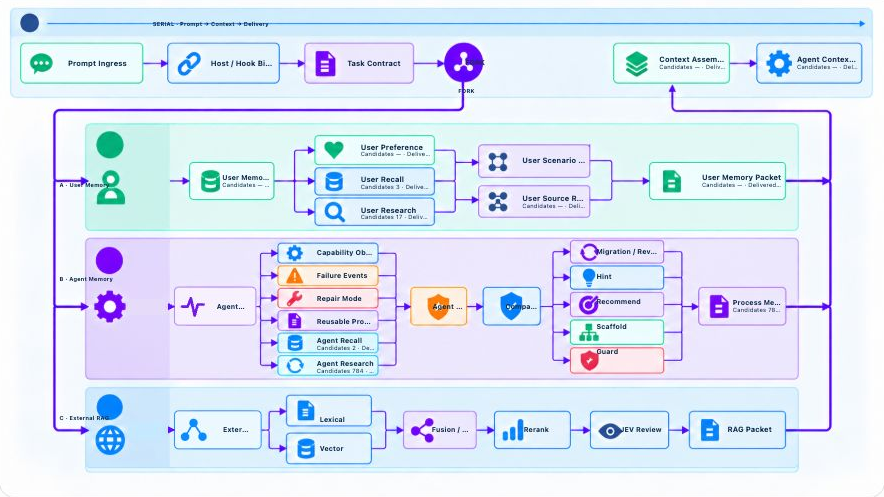
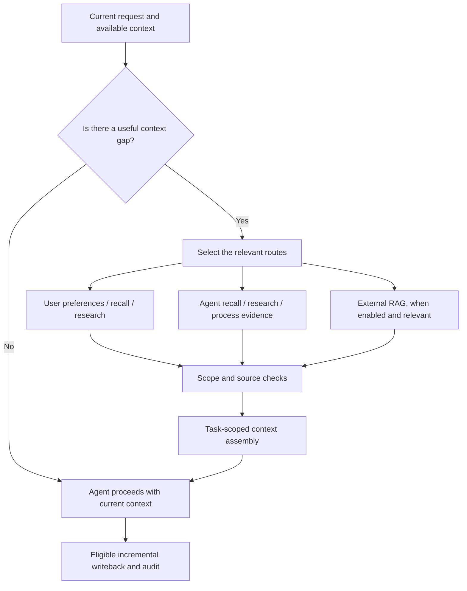

# Evolving Profile

<div align="center">

**Personal context. Reusable agent experience. Observable memory workflows.**

Make long-running AI collaboration easier to continue, inspect, and control.

[简体中文](README-中文.md) · [Quick start](#ep-quick-start) · [How it works](#ep-how-it-works) · [Agent installation](#ep-agent-setup) · [Release status](docs/RELEASE-LEDGER.md)

</div>

You have explained the project before. Your agent has solved a similar problem before.
Why do you still have to repeat the context—and watch it take the same detour?

**Evolving Profile (EP)** organizes user knowledge, agent process experience, and
external documents as separate memory planes, then coordinates the useful routes
for the current task. Its console helps you inspect not only what was found, but
what was returned, what delivery evidence exists, and what still needs checking.

It is more than a place to store conversation text: it is a memory and evidence
workflow for continuing real work across conversations.


## See the workflow



A real console capture of an existing historical audit record, cropped to exclude
the private Prompt list. Historical source attribution is not a natural-user benchmark. Branches are
available routes, **not a claim that every route runs on every request**. Counts
describe the selected recorded invocation; they are not an accuracy benchmark or
proof that a final answer adopted the returned content.

<details>
<summary>Inspect a receipt, not just a diagram</summary>


Node details expose the evidence available for that step. No receipt, an observed
empty result, an excluded candidate and unknown host visibility are different states.

</details>

## What EP brings to your workflow

| Capability | Practical value |
| --- | --- |
| **User memory** | Keep facts, experiences, entities, multi-dimensional preferences and mental-model references organized instead of repeatedly explaining everything. |
| **Agent process memory** | Retain traces, failures, repairs, capability observations and reusable strategy candidates—not just the final answer. |
| **Layered scenario navigation** | Locate the relevant Session and stage before expanding context or reading original evidence. |
| **Separate external knowledge** | Search your selected document collection without treating a PDF as your personal history or preference. |
| **Observable memory routes** | Diagnose whether a problem occurred during retrieval, admission, return, delivery or source readback. |
| **Modular controls** | Configure memory modules, providers, retrieval models, optional judges and budgets for the workflow you actually need. |

These capabilities provide structured evidence and reusable context; they do not
guarantee that every old memory is correct or every future task will improve.

## Three memory planes, different responsibilities


**User memory** holds facts, experiences, entities/relations, observations,
conditional preferences, mental-model references and scenario navigation.
A preference retains its conditions and exceptions; a project-local instruction
should not silently become a permanent global rule.

**Agent process memory** follows what the agent tried, where it failed, how it
repaired the problem and what verification was observed. It organizes failures,
repair patterns, strategies, capability observations and transfer/revalidation.
Experience remains scoped to tasks, tools, time and available evidence; it is
not automatically installed as a Skill or a permanent command for newer models.

**External RAG** is for an operator-selected collection of PDF, Word, Markdown
and other supported files. It offers lexical/vector retrieval, reciprocal-rank
fusion (RRF), optional model reranking and index compatibility/rebuild controls.
It is optional—not a second index that EP's internal memory must use.

<a id="ep-how-it-works"></a>

## How it works



The agent can combine routes when a task needs both personal context and
execution experience. Explicit source restrictions still take priority.

### Navigate first, expand when needed

Scenario Summary has **three tiers: compact → standard → full**. It locates the
conversation, stage, constraints and later corrections; it is not a substitute
for exact original wording.

When the summaries are insufficient, use the bounded original Session/Project
reading route. Use source readback for consequential names, amounts, versions,
negations and conflicts. The right reader depends on the available source
locator; a local transcript path is not automatically a Bank `read_source` ID.

### Keep evidence states distinct

```text
discovered ≠ returned ≠ delivery observed ≠ source read ≠ answer adoption confirmed
```

This separation makes weak or uncertain evidence usable as navigation without
turning it into a verified fact. Relevance controls can retain weak background
while excluding unrelated content; relevance is not a truth score.

## Typical uses

- **Resume a project:** locate earlier decisions, constraints and corrections
  without merging unrelated projects from the same organization.
- **Adapt collaboration:** consult conditional preferences for the current task,
  rather than inject every preference into every answer.
- **Reuse execution experience:** retrieve earlier debugging or production
  lessons, then check whether their prerequisites still apply.
- **Work with outside documents:** compare your own history with a supplied
  document while preserving the two source categories.
- **Explain an apparent memory failure:** inspect the actual route and receipt
  instead of guessing that “the model forgot.”

## Configure behavior and cost

The web console exposes user/agent memory modules, Provider/Fallback,
Embedding/Rerank models, external RAG, Scenario Summary, JEV, backup and audit
settings. Recording, retrieval and context use have distinct responsibilities;
module switches do not mean deleting the stored records.

- Use local or online retrieval models where supported; verify the actual model
  path/service and index signature before treating it as ready.
- Enable external RAG only for the collections you want searched.
- **JEV is optional:** it can assist selected routing/evidence-review stages;
  it does not replace the retriever or write facts. Its configured rule-based
  fallback and unknown/error states remain visible.
- High-risk judgment is a separate opt-in setting, not permission to override
  the host's existing authority and source-verification boundaries.
- Background extraction and optional online judgment can consume provider
  tokens. Local models have their own memory/startup cost. Use module controls,
  bounded expansion, pagination and budgets rather than assume memory is free.

Experimental whole-history model trials are not enabled by the installer.
Existing historical records may remain pending, protected or unknown; those
statuses are not erased merely to make a dashboard green.

<a id="ep-quick-start"></a>

## Quick start

### Requirements

- Python **3.11+**, `uv`, Node.js **20.9+**, npm and Git.
- PostgreSQL with pgvector for the full API, or the explicitly installed
  `embedded-db` extra for a supported embedded route.
- A configured chat provider and a working embedding route; a chat-only plan
  does not necessarily include embeddings.
- macOS was exercised locally. Linux is a target with platform prerequisites;
  Windows-native installation is not certified here.

### 1. Install and build

```bash
git clone --branch release/5.1.0 https://github.com/ccygod/evolving-profile-2.2.git
cd evolving-profile-2.2
./scripts/install-ep51.sh --mode local --no-launch
```

This runs preflight and a release text-source scan, installs base dependencies,
builds the SDK **before** the Console and writes a local launch manifest.
It creates `.env` only when absent. **It does not start services or register MCP/Hook.**

Use `--dry-run` for zero-write inspection. Use `--skip-deps` only when this
checkout's dependencies already exist—not for the first install.

### 2. Configure your own services

Fill the generated local `.env` using [API configuration](api/README.md).
Prepare your database and embedding service. Base dependencies do not include
embedded PostgreSQL or local ML; select the required extras explicitly.
Use the same Bank ID in the API, Controller and host configuration. Changing a
Console selector alone does not configure a host's memory namespace.

No production Bank, private transcript, credentials or local model weights are
provided. JEV, cloud backup and external RAG are not enabled by installation.

### 3. Start API and Console

From the repository root, in separate terminals:

```bash
uv run --project api evolving-profile-api --host 127.0.0.1 --port 8888 --workers 1
```

```bash
node --env-file=.env console/bin/cli.js --hostname 127.0.0.1 --port 9999 --api-url http://127.0.0.1:8888
```

Open [the local Console](http://127.0.0.1:9999). Create your own Bank and verify
health, real page interactions and the chosen model route.
See [complete setup, upgrade and rollback](docs/LOCAL-SETUP.md).

**API/Console startup is not full host integration.** Controller, Hook, Guidance
and background workers have separate setup and readiness requirements. An API
HTTP MCP handshake does not certify host `user_recall`, `agent_research` or
context delivery. Do not expose local ports publicly without access control.

<a id="ep-agent-setup"></a>

## Let your agent set it up

Give this to an agent with terminal and browser permission:

```text
Install Evolving Profile release/5.1.0 from
https://github.com/ccygod/evolving-profile-2.2 in a new directory.
Read README, docs/LOCAL-SETUP.md and api/README.md first.
Run ./scripts/install-ep51.sh --mode local --no-launch; do not skip fresh dependencies.
Configure my own database, chat and embedding routes through a safe local
credential flow. Never invent credentials, overwrite an existing installation
or copy private Banks, transcripts, receipts or .env files.
Start API and production Console, verify health and real browser interactions,
and open http://127.0.0.1:9999. If a port is occupied, use a free port and update
the related URLs; do not kill an unrelated process.
Separately inspect the host integration and tell me which MCP/Hook/worker
steps are verified, unavailable or still require configuration.
Do not call a build “running,” an HTTP handshake “full host integration,”
or a failed check “complete.” Do not enable optional external services without my choice.
```

For **Codex**, prioritize the existing EP MCP/Hook route. For **Claude Code** and
**Hermes**, use the shared adapter contracts but verify each host's transcript
lifecycle and capabilities separately. This prompt delegates setup work; it
does not make missing services or credentials appear automatically.

## Host compatibility

| Host | Current position | Do not assume |
| --- | --- | --- |
| **Codex** | Most deeply exercised MCP/Hook, memory-route, scenario and receipt path | Every black-box answer has an adoption receipt |
| **Claude Code** | Shared Controller/MCP and transcript/Hook bridge can be reused | Identical native lifecycle or one-command onboarding |
| **Hermes** | Shared memory services and compatible MCP/API contracts can be reused | Identical capability probes, receipts or onboarding |

Dedicated Claude Code/Hermes onboarding and adaptation remain improvement work
for a subsequent version. No equal-validation claim is made.

## Reliability, privacy and limits

- Memory candidates, scenario summaries and process patterns are not verified
  external facts. Assistant completion statements retain their evidence level.
- Tool invocation and returned content do not prove final-answer adoption.
- UI language selection includes English and Chinese; backend-generated
  diagnostics and user-authored source text are not guaranteed fully translated.
- Source-text scanning is not a binary-asset audit or dependency-risk guarantee.
- All-history semantic accuracy and answer benefit are not globally certified.

Product version: [`VERSION`](VERSION). Current release status, actual checks,
dependency risks and known limits belong in the [release notes](docs/RELEASE-NOTES-5.1.0.md)
and [release ledger](docs/RELEASE-LEDGER.md), not in a permanently duplicated badge.
See the [dependency risk disposition](docs/DEPENDENCY-RISKS.md) for the distinct
production-classified and full-workspace audit results and retained RC risks.

## Authorship, source and documentation

EP distribution author/maintainer: **CCY**. The
[personal distribution](https://github.com/ccygod/evolving-profile-2.2) and
[upstream contribution](https://github.com/94Hao94/evolving-profile/pull/4) are
two channels for the same release line, not unrelated implementations.
Preserve [NOTICE](NOTICE.md) and the applicable upstream licenses. Repository
ownership, Git commit identity and upstream acknowledgment remain distinct.

- [中文介绍](README-中文.md)
- [Local setup and rollback](docs/LOCAL-SETUP.md) · [API configuration](api/README.md)
- [Changelog](CHANGELOG-5.1.md) · [Release notes](docs/RELEASE-NOTES-5.1.0.md)
- [Source-of-truth map](config/source-of-truth.json) · [Security policy](SECURITY.md)
