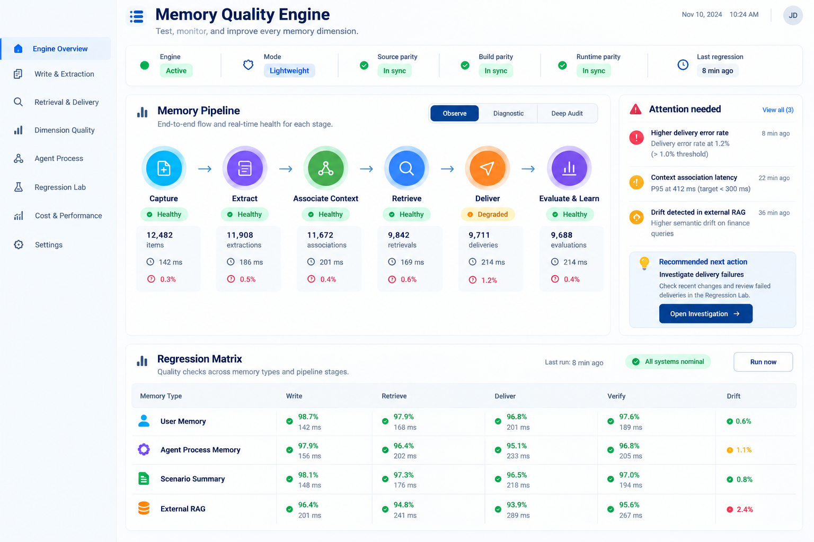
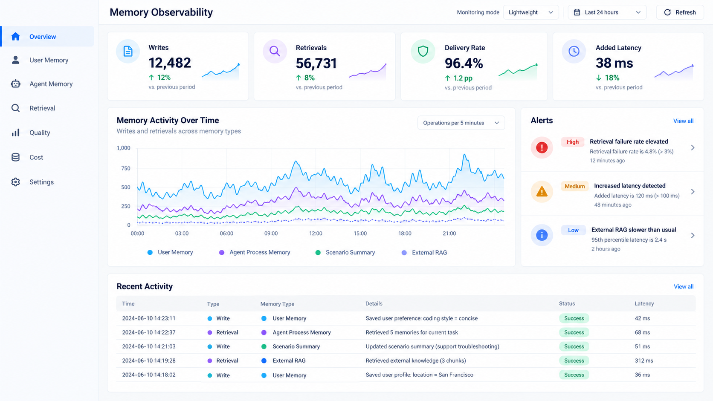
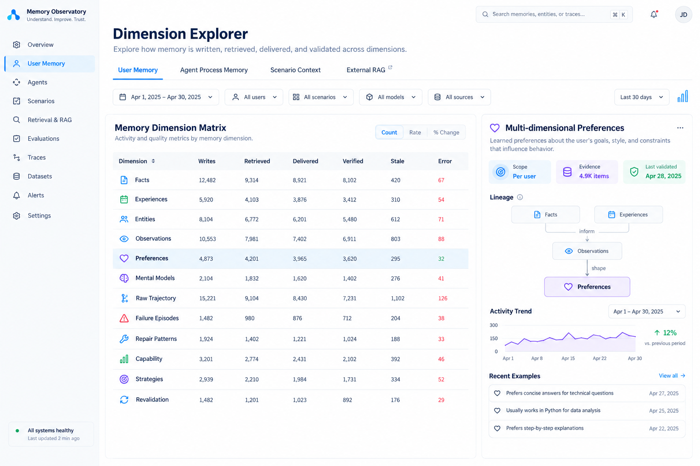
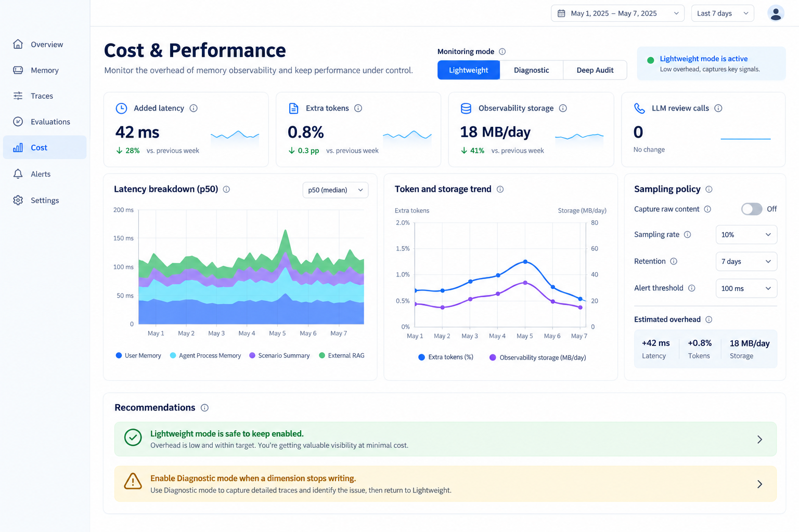

# Evolving Profile 5.1 — Memory Quality & Observability Engine PRD

状态：架构与产品设计稿，待实现  
版本：EP 5.1  
对象：EP 用户记忆、Agent Process Memory、Scenario Summary、External RAG、链路回执与开发回归

## 视觉方向预览

以下是 ImageGen 生成的布局探索稿，不是最终实现截图。它们用于确定信息层级、页面分区和交互密度，最终实现必须以真实数据、回执和真实浏览器验收为准。









## 0. 产品定位

EP 5.1 不只是增加一个监控页面，而是增加一个独立的 **Memory Quality & Observability Engine**（记忆质量与观测引擎）。

它持续回答：

- 某个记忆维度有没有被正确写入和提炼？
- 某个维度有没有被正确召回、送达和回读？
- 用户记忆、智能体过程记忆、情景摘要和外部 RAG 是否互相污染？
- 新增维度或修改路由后，旧能力有没有回归？
- 监控本身增加了多少 Token、延迟、IO 和模型调用？
- 当前源码、构建产物和运行服务是否为同一版本？

目标是让未来的 EP 升级从“出了问题再人工翻 Session”变成：

```text
写入/提炼 → 召回/送达 → 质量评估 → 回归对比 → 异常告警 → 定位修复
```

## 1. 背景与问题

EP 记忆维度已经从 Facts、Experiences、Entities、Observations、Preferences、Scenario Summary 扩展到 Agent Process Memory 的 Trajectory、Failure Episode、Repair Pattern、Capability Observation、Strategy、Revalidation，以及 External RAG。

过去新增或修改维度时，主要依靠：

- 翻历史 Session；
- 手工查 Prompt；
- 手工核对链路页；
- 对照 API 返回；
- 重新做若干测试题；
- 再用 Computer Use 检查页面。

这种方式的问题是：发现晚、成本高、不可连续观测，且容易把“没有调用”“调用后为空”“返回但未送达”“送达但未确认采用”混为一谈。

## 2. 产品目标

### 2.1 必须实现的目标

1. 为用户记忆和 Agent Process Memory 建立统一但可扩展的观测事件模型。
2. 记录写入、提炼、关联、召回、送达、原文回读、验证、晋升和回归结果。
3. 提供轻量常态、诊断和深度审计三种观测模式。
4. 在 Web 端展示维度健康、运行链路、质量异常、回归结果、Token/延迟/存储成本。
5. 支持按记忆平面、维度、路由和任务关闭/开启观测。
6. 监控本身不得改变记忆语义、检索排序或 Agent 最终答案。
7. 未来新增记忆维度时，只需登记 dimension manifest 和 evaluator，不需要重新手工设计整套监控。

### 2.2 不属于本版本的目标

- 不把 Langfuse、Phoenix 或 OpenTelemetry Collector 整套引入 EP 运行时；
- 不用监控引擎替代 Recall、Research 或 Agent 判断；
- 不默认保存全部原始 Prompt、记忆正文或完整模型思维过程；
- 不因为发现异常就自动改写 Facts、Preferences 或 Agent Skill；
- 不把单次成功自动升级成全局过程技能。

## 3. 核心设计原则

### 3.1 观察与改变分离

Memory Quality Engine 默认是只读观测层。它可以产生诊断、评分、告警和建议，但不能直接修改记忆本体。

### 3.2 轻量优先，深度按需

常态记录结构化事件；诊断时才记录候选 ID 和路由细节；深度审计时才允许有限正文采样或评估器调用。

### 3.3 真实状态优先

```text
未调用 ≠ 调用但为空 ≠ 返回候选 ≠ 已送达 ≠ 已原文回读 ≠ 已确认答案采用
```

### 3.4 观测维度开放集合

核心维度保持稳定，但新增维度必须通过 manifest 注册，不把具体的 Facts/Agent 模块清单硬编码成永久上限。

### 3.5 版本可追溯

每条观测事件保存 source_revision、build_revision、runtime_revision 和 config_generation，避免验证旧源码而用户打开新旧不明服务。

## 4. 观测事件模型

统一事件名：`memory_quality_event`。

```json
{
  "event_id": "evt_...",
  "trace_id": "trace_...",
  "prompt_id": "prompt_...",
  "session_id": "session_...",
  "project_id": "project_...",
  "plane": "user_memory|agent_process|scenario|external_rag|audit",
  "dimension": "facts|experiences|preferences|trajectory|episode|pattern|...",
  "stage": "capture|extract|associate|retrieve|deliver|readback|verify|promote|revalidate",
  "route": "user_recall|agent_research|user_preference|external_rag|...",
  "status": "observed|returned_zero|delivered|unavailable|failed|not_measured",
  "candidate_count": 0,
  "returned_count": 0,
  "delivered_count": 0,
  "readback_count": 0,
  "verified_count": 0,
  "latency_ms": 0,
  "extra_tokens": 0,
  "llm_calls": 0,
  "source_ids": [],
  "source_revision": "...",
  "build_revision": "...",
  "runtime_revision": "...",
  "config_generation": "...",
  "sampling_mode": "lightweight",
  "created_at": "..."
}
```

观测事件只保存必要元数据；原文、候选正文和敏感内容由模式与 retention policy 控制。

## 5. 观测模式

### 5.1 Lightweight（默认建议）

记录：调用次数、状态、计数、延迟、Token、版本和错误码。  
不记录：原始正文、不新增 LLM 判断、不执行额外 Recall。

目标开销：额外 Token 为 0；额外延迟目标低于一个可配置的小阈值；只产生少量本地事件 IO。

### 5.2 Diagnostic

在某个维度停止写入、召回为 0、送达数量异常或页面显示异常时开启。增加候选 ID、来源 ID、过滤原因、节点投影和失败堆栈摘要。

### 5.3 Deep Audit

仅用于开发新维度、专项回归和重大升级。允许有限正文采样、来源片段、评估器调用、完整链路快照和 LLM-as-a-judge，但必须显示额外 Token、延迟、模型调用次数和存储量。

## 6. 监控对象

### 6.1 User Memory

- Facts、Experiences、Entities、Observations、Preferences、Mental Models；
- 多维度偏好的条件、例外和形成原因是否完整；
- Project/Session/Conversation 关联是否存在；
- Scenario Summary 是否覆盖且没有过期；
- 重复、冲突、孤立和无来源记录。

### 6.2 Agent Process Memory

- Raw Trajectory；
- Failure Episode；
- Repair Pattern；
- Capability Observation；
- Process Strategy；
- Transfer/Revalidation；
- 验证证据、模型兼容性、负迁移、漂移和晋升状态。

### 6.3 Retrieval and Delivery

每次 User/Agent Recall、Research、Preference、Scenario、Source Readback 和 External RAG 都记录候选、返回、送达、回读和采用未知状态。

### 6.4 Quality and Drift

- 某维度写入量长期下降；
- 某维度召回一直为空；
- 返回数和送达数异常不一致；
- 父子节点显示数量不一致；
- Agent Pattern 无验证证据；
- RAG 索引模型漂移；
- 旧经验在新模型上出现负迁移；
- 跨项目或跨 Session 关联异常。

### 6.5 Performance and Cost

- 观测增加的延迟；
- 额外 Token；
- 额外 LLM 调用；
- 本地事件写入量；
- 观测存储增长；
- 队列积压和失败重试。

## 7. Web 端信息架构

新增主菜单：**Memory Quality Engine / 记忆质量引擎**。

### 7.1 Engine Overview

- 引擎开关；
- Lightweight/Diagnostic/Deep Audit；
- Source/Build/Runtime parity；
- 最近回归时间；
- 总写入、召回、送达、验证、错误和延迟；
- Attention Needed；
- Recommended Next Action。

### 7.2 Write & Extraction

查看每个记忆维度的提取量、成功率、失败率、平均延迟、重复率和冲突率。

### 7.3 Retrieval & Delivery

查看每条路由的调用、候选、返回、送达、原文回读和未测量状态，并可打开原始 receipt。

### 7.4 Dimension Quality

提供维度矩阵：

```text
Dimension | Write | Retrieve | Deliver | Verify | Stale | Error | Drift
```

点击某个维度进入来源谱系、时间趋势和异常样本。

### 7.5 Agent Process

展示 Episode、Pattern、Capability、Strategy、Revalidation 的生命周期和验证证据。

### 7.6 Regression Lab

支持固定样本、历史 Prompt、留出集、跨模型对照和回归矩阵。测试结果必须区分 fixture evidence 与真实历史 evidence。

### 7.7 Cost & Performance

显示当前模式的额外延迟、Token、LLM 调用和存储增长，并给出“可继续开启/建议关闭/建议进入诊断”的解释。

### 7.8 Settings

- 总开关；
- 按 plane/dimension/stage 开关；
- 采样比例；
- 是否记录原文；
- retention；
- Token/延迟告警阈值；
- 是否自动运行回归；
- 是否允许评估器调用。

## 8. 技术栈建议

### 8.1 事件与标准

优先采用 OpenTelemetry/GenAI 语义思想，但使用 EP 自己的 `memory_quality_event` 作为领域事件。未来可以提供 OTLP exporter，不要求运行时必须依赖 Collector。

### 8.2 Console

- Next.js/React：页面和路由；
- Recharts 或 ECharts：趋势、分布和成本图；
- TanStack Table：维度矩阵、分页和筛选；
- React Flow + ELK：质量链路和维度关系图；
- Radix UI：Tabs、Dialog、Switch、Popover、Tooltip；
- CSS variables：统一状态颜色和 density；
- Playwright + Computer Use：真实用户界面回归。

### 8.3 后端

- 事件写入采用追加式 ledger；
- 聚合指标使用可重建 projection；
- 原始正文与结构化指标分开 retention；
- 不在查询页面实时触发昂贵 LLM 调用；
- 质量评估和深度审计走后台队列。

### 8.4 可借鉴但不强制接入

- Langfuse：trace/session/agent graph/evaluation；
- Phoenix：OpenTelemetry/OpenInference tracing 和 evaluator traces；
- OpenTelemetry：跨服务的 trace/span 语义。

EP 5.1 不整套绑定这些服务，避免额外部署、账号和运行成本。

## 9. 分阶段实施

### Phase 1 — Event Contract

完成事件 schema、轻量采集、版本 parity、开关和基础聚合。

### Phase 2 — Console Overview

完成 Engine Overview、模式切换、成本指标、告警和运行状态。

### Phase 3 — Dimension Quality

完成 User Memory/Agent Process Memory 维度矩阵、来源谱系和异常样本。

### Phase 4 — Regression Lab

完成 fixture/历史样本区分、回归矩阵、留出集、跨模型对比和报告导出。

### Phase 5 — Deep Audit

完成诊断采样、正文留存、评估器、漂移和负迁移分析。

## 10. 验收标准

### Functional

- 轻量模式不产生额外 LLM 调用；
- 开关可以按 plane、dimension、stage 生效；
- 所有事件可绑定 prompt/session/project/trace；
- 节点和事件计数可追溯到来源；
- 关闭观测不删除记忆数据；
- 深度审计开启时清晰显示额外成本。

### Quality

- 能发现写入缺失、召回为空、送达不一致、父子节点数量污染和版本漂移；
- 能区分真实历史 evidence 与 fixture evidence；
- 能显示 Agent Process Memory 的晋升和再验证证据；
- 回归实验不会自动修改生产记忆。

### UX

- 总览首屏能看懂当前健康状态；
- 复杂数据通过标签页、抽屉和下钻展示，不堆在一页；
- 所有数字可点击查看来源和计算边界；
- 中英文 README 分离，UI 仍按现有多语言策略工作；
- 真实 Chrome 和窄视口通过验收。

## 11. 参考资料

- OpenTelemetry AI Agent Observability: https://opentelemetry.io/blog/2025/ai-agent-observability/
- Langfuse Agent Graphs: https://langfuse.com/docs/observability/features/agent-graphs
- Langfuse Observability: https://langfuse.com/docs/observability/overview
- Phoenix: https://arize.com/docs/phoenix/
- Phoenix Evaluation: https://arize.com/docs/phoenix/evaluation/llm-evals/evaluator-traces
